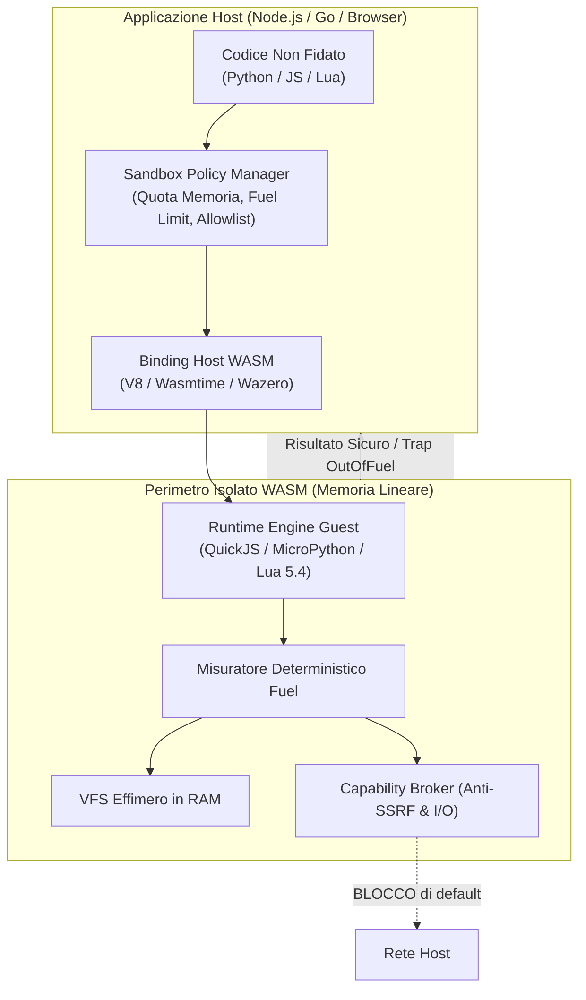

# WASM-Sandbox 🛡️⚡

**Micro-Ambienti Isolate in WebAssembly per l'Esecuzione Sicura di Codice Non Fidato**

[English](README.md) | [Italiano](README.it.md)

[](LICENSE)
[](COMMERCIAL.md)
[](https://github.com/sponsors/MRJonam91)
[](https://ko-fi.com/mrjonam)
[](https://buymeacoffee.com/mrjonam)
[](https://paypal.me/manorollo)

---

## 🎬 Dimostrazione Interattiva (5 Secondi)



---

## 💡 Perché WASM-Sandbox?

L'esecuzione di codice arbitrario non fidato fornito da utenti (Python, JavaScript, Lua) è un requisito cruciale per moderni **Agenti AI autonomi**, **Sistemi di Plugin** e **Piattaforme SaaS Multi-Tenant**.

L'approccio tradizionale basato su container Docker o micro-VM comporta:
- 🐌 **Cold Start Lenti**: Da 500ms a oltre 2000ms di latenza per avviare un singolo container.
- 💾 **Spreco di Memoria RAM**: 150MB–500MB di RAM per ogni istanza.
- ⚙️ **Complessità Architetturale**: Impossibile da eseguire in ambienti edge a bassa latenza o nel browser client.

**WASM-Sandbox** risolve questo problema grazie ai micro-isolati WebAssembly:
- ⚡ **Avvio Istantaneo in `< 0.5ms`** con meno di `4MB` di RAM a riposo.
- 🛑 **Fuel / Gas Metering Deterministico**: Interrompe loop infiniti e abusi di calcolo computazionale contando le istruzioni bytecode, senza affidarsi a timer asincroni del sistema operativo.
- 🔒 **Limiti Rigidi di Memoria Lineare**: Impossibile causare buffer overflow o memory leak verso il processo host.
- 🛡️ **Rete e Filesystem Zero-Trust**: Filesystem effimero in-memory (VFS) e Capability Broker anti-SSRF (blocco preventivo di endpoint metadata cloud `169.254.169.254` e subnet private).

---

## 🏗️ Schema Architetturale



---

## 📦 Core Modulare Facile da Estendere (<1.500 LOC)

Il layer di astrazione principale (`@wasm-sandbox/core`) è mantenuto rigorosamente **sotto le 1.500 righe di codice TypeScript strict** per consentire a chiunque di comprendere il modello di isolamento e implementare nuovi engine o adapter in meno di un'ora:

```
packages/
├── core/                  # Core pulito (< 500 LOC): types, policy, VFS in-memory, broker
├── engine-quickjs/        # Engine JavaScript (QuickJS WASM) con hook carburante
├── engine-python/         # Engine Python (MicroPython / WASI)
├── engine-lua/            # Engine Lua 5.4 VM
├── runtime-node/          # Adapter host per Node.js (V8 WASM / Worker thread isolation)
├── runtime-go/            # Adapter host per Go puro (Wazero, zero CGO)
└── runtime-browser/       # Adapter per client Web Worker nel browser
```

---

## 🚀 Esempio Rapido di Utilizzo

```typescript
import { InMemoryVFS, CapabilityBroker, resolvePolicy } from '@wasm-sandbox/core';

// 1. Definisci le restrizioni della sandbox
const policy = resolvePolicy({
  maxMemoryBytes: 16 * 1024 * 1024, // Limite rigido: 16 MB di memoria lineare
  fuelLimit: 10_000_000,             // Trap automatica dopo 10 milioni di istruzioni
  capabilities: {
    network: { allowlist: ['api.github.com'] }, // Tutto il resto è bloccato
    filesystem: { readOnly: true }
  }
});

// 2. Inizializza il broker e il filesystem virtuale in RAM
const broker = new CapabilityBroker(policy.capabilities.network.allowlist);
const vfs = new InMemoryVFS({ '/app/entry.js': 'console.log("Sandbox Sicura");' });

// 3. SSRF e reti private sono neutralizzati a priori
broker.isNetworkAllowed('http://169.254.169.254'); // false (SSRF bloccato!)
broker.isNetworkAllowed('https://api.github.com');  // true
```

---

## 💖 Supporto e Donazioni

WASM-Sandbox è un progetto attivo e indipendente. Se trovi utile questo strumento per la tua azienda o i tuoi progetti:
- **GitHub Sponsors**: [github.com/sponsors/MRJonam91](https://github.com/sponsors/MRJonam91)
- **Ko-fi**: [ko-fi.com/mrjonam](https://ko-fi.com/mrjonam)
- **Buy Me A Coffee**: [buymeacoffee.com/mrjonam](https://buymeacoffee.com/mrjonam)
- **PayPal**: [paypal.me/manorollo](https://paypal.me/manorollo)

---

## ⚖️ Doppia Licenza e Disponibilità alla Vendita

WASM-Sandbox è rilasciato con modello di **Doppia Licenza**:
1. **Open-Source (GNU AGPLv3)**: Gratuita per progetti open-source conformi agli obblighi di licenza copyleft via rete (AGPL-3.0).
2. **Licenza Commerciale & Enterprise**: Per piattaforme SaaS proprietarie, codice chiuso, agenti AI commerciali o integrazioni OEM senza vincoli di rilascio del codice.
3. **Vendita / Cessione dell'Intero Progetto (Full IP Buyout)**: L'intera proprietà intellettuale, il copyright e i diritti mondiali di sfruttamento commerciale sono disponibili per proposte di acquisizione da parte di aziende o investitori.

Per informazioni su licenze commerciali e acquisizione dell'intero progetto, consulta [COMMERCIAL.md](COMMERCIAL.md) oppure contatta direttamente l'autore **Manoj Rollo (@MRJonam91)** a [fbxmano@gmail.com](mailto:fbxmano@gmail.com).
