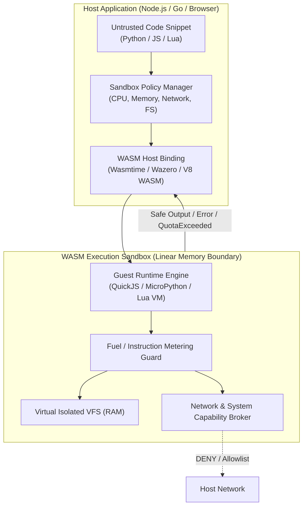

# WASM-Sandbox 🛡️⚡

**Micro-Ambienti Isolate in WebAssembly per l'Esecuzione Sicura di Codice Non Fidato**

[](LICENSE)
[]()
[]()

---

## 💡 Vision & Concetto

**WASM-Sandbox** è un runtime e una libreria ad alte prestazioni progettata per eseguire codice non fidato (Python, JavaScript, Lua compilati o interpretati all'interno di WebAssembly) con:
- **Limiti deterministici di CPU e Istruzioni (Fuel/Gas Metering)**
- **Quota rigida di memoria isolata (Linear Memory Boundaries)**
- **Isolamento completo da host OS e filesystem (Virtual In-Memory VFS)**
- **Capability-Based Security (Accesso di rete bloccato di default, con policy allowlist granulare)**

### Perché WASM-Sandbox?
Le architetture moderne basate su estensioni utente (Plugin System), piattaforme SaaS multi-tenant e **Agenti AI autonomi** necessitano dell'esecuzione dinamica di codice generato o inserito dall'utente.
L'utilizzo di container Docker tradizionali o VM micro-VM (es. Firecracker) comporta:
1. **Latenza di avvio elevata** (centinaia di millisecondi o secondi vs microsecondi in WASM).
2. **Elevato consumo di RAM** (decine di MB per container vs pochi KB/MB per istanza WASM).
3. **Complessità di orchestrazione** su piattaforme serverless, edge o direttamente nel browser.

WASM-Sandbox offre isolamento a livello di processo con overhead minimale, perfetto sia per backend (Node.js, Go) che client (Browser / WebWorkers).

---

## 🏗️ Architettura ad Alto Livello



---

## 🎯 Caratteristiche Chiave

| Funzionalità | Descrizione |
| :--- | :--- |
| **Fuel / Gas Metering** | Interruzione garantita dei loop infiniti e computazioni DoS a livello di istruzioni WASM (senza affidarsi a `setTimeout`). |
| **Memory Isolation** | Assegnazione statica e dinamica della memoria lineare WASM: nessun buffer overflow verso l'host. |
| **Capability Sandbox** | Nessun accesso implicito a syscall POSIX, filesystem reale o socket di rete. |
| **Multi-Language Guest** | Supporto nativo per l'interpretazione di **JavaScript** (QuickJS), **Python** (MicroPython / Pyodide WASI) e **Lua** (Lua 5.4 WASM). |
| **Multi-Host Target** | Compatibilità con backend Node.js (V8 WASM / Wasmtime bindings), Go (Wazero pure Go WASM runtime) e Browser. |
| **Instant Cold Start** | Avvio di una sandbox in `< 1ms` e footprint di memoria a riposo `< 5MB`. |

---

## 📂 Struttura del Repository

```
WASM-Sandbox/
├── packages/
│   ├── core/                  # Specifiche, tipi e abstraction layer del Sandbox
│   ├── engine-quickjs/        # Engine guest JavaScript ultra-leggero (QuickJS WASM)
│   ├── engine-python/         # Engine guest Python (MicroPython / WASI)
│   ├── engine-lua/            # Engine guest Lua (Lua 5.4 WASM)
│   ├── runtime-node/          # Adapter e bindings per backend Node.js
│   ├── runtime-go/            # Adapter per Go (Wazero pure Go)
│   └── runtime-browser/       # Adapter per esecuzione Web / WebWorker
├── docs/                      # Specifiche tecniche, threat model e benchmark
│   ├── ARCHITECTURE.md        # Dettaglio tecnico del design
│   ├── THREAT_MODEL.md        # Modello di minacce e garanzie di sicurezza
│   ├── ROADMAP.md             # Fasi di sviluppo e milestone
│   └── BENCHMARKS.md          # Metodologia di test prestazioni
├── examples/                  # Esempi pratici di integrazione
├── .github/                   # Workflows CI/CD, issue & PR templates
├── LICENSE                    # Apache 2.0 License
└── README.md                  # Questo file
```

---

## 🚀 Prossimi Passi

1. **Analisi e Specifiche Tecniche**: Consulta [ARCHITECTURE.md](docs/ARCHITECTURE.md) e [THREAT_MODEL.md](docs/THREAT_MODEL.md).
2. **Tabella di Marcia**: Segui le milestone in [ROADMAP.md](docs/ROADMAP.md).
3. **Contributi e Sicurezza**: Consulta [CONTRIBUTING.md](CONTRIBUTING.md) e [SECURITY.md](SECURITY.md).
