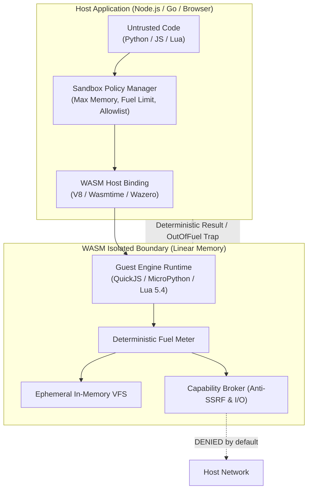

# WASM-Sandbox 🛡️⚡

**Micro-Isolated WebAssembly Environments for Safe Untrusted Code Execution**

[English](README.md) | [Italiano](README.it.md)

[](LICENSE)
[](COMMERCIAL.md)
[](https://github.com/sponsors/MRJonam91)
[](https://ko-fi.com/mrjonam)
[](https://buymeacoffee.com/mrjonam)
[](https://paypal.me/manorollo)

---

## 🎬 5-Second Interactive Demo



---

## 💡 Why WASM-Sandbox?

Running untrusted user code (Python, JavaScript, Lua) is a critical requirement for modern **AI Agents**, **Plugin Marketplaces**, and **Multi-Tenant SaaS platforms**. 

Traditional isolation via Docker containers or micro-VMs imposes:
- 🐌 **Heavy Cold Starts**: 500ms–2000ms spin-up latency per container.
- 💾 **Bloated Memory Overhead**: 150MB–500MB RAM per instance.
- ⚙️ **Complex Orchestration**: Impossible to run efficiently at edge or directly inside browser client sessions.

**WASM-Sandbox** solves this with WebAssembly micro-isolates:
- ⚡ **Cold Start in `< 0.5ms`** with `< 4MB` baseline RAM.
- 🛑 **Deterministic CPU / Fuel Metering**: Terminate infinite loops and runaway computations without relying on asynchronous OS thread timers.
- 🔒 **Linear Memory Hard Bounds**: Zero possibility of host memory buffer overflow or process memory leaks.
- 🛡️ **Zero-Trust Network & Storage**: Virtual in-memory ephemeral filesystem (VFS) and anti-SSRF capability broker (blocking metadata endpoints like `169.254.169.254` and private networks by default).

---

## 🏗️ Architecture



---

## 📦 Easy-to-Extend Modular Core (<1,500 LOC)

The core abstraction layer (`@wasm-sandbox/core`) is strictly maintained **under 1,500 lines of clean, strictly-typed TypeScript** to allow anyone to comprehend the entire isolation model and build a new custom engine or host adapter in less than an hour:

```
packages/
├── core/                  # Clean core (< 500 LOC): types, policy, in-memory VFS, broker
├── engine-quickjs/        # JavaScript (QuickJS WASM) engine with fuel hook
├── engine-python/         # Python (MicroPython / WASI) engine
├── engine-lua/            # Lua 5.4 VM engine
├── runtime-node/          # Node.js host adapter (V8 WASM / Worker thread isolation)
├── runtime-go/            # Pure Go host adapter (Wazero, zero CGO)
└── runtime-browser/       # Web Worker client adapter
```

---

## 🚀 Quickstart Example (MVP Live)

```typescript
import { WasmSandbox } from '@wasm-sandbox/core';

// 1. Create a secure WebAssembly sandbox with strict resource limits
const sandbox = await WasmSandbox.create({
  maxMemoryBytes: 16 * 1024 * 1024, // 16 MB max linear memory
  fuelLimit: 50_000,                 // Stops infinite loops deterministically
  capabilities: {
    network: { allowlist: ['api.github.com'] },
    filesystem: { readOnly: false }
  }
});

// 2. Safely execute untrusted user code
const result = await sandbox.execute(`
  console.log("Running inside WebAssembly micro-isolate!");
  
  // Safe isolated Virtual In-Memory Filesystem (RAM only)
  fs.writeFile('/notes/user.txt', 'Safe data');
  const readBack = fs.readTextFile('/notes/user.txt');
  
  // Return computation
  ({ status: 'ok', file: readBack, sum: [10, 20, 30].reduce((a, b) => a + b, 0) });
`);

console.log(result.value);
// => { status: 'ok', file: 'Safe data', sum: 60 }
console.log('Stdout captured:', result.stdout);
console.log(`Execution time: ${result.metrics.executionTimeMs}ms`);
```

### 💻 CLI Usage

```bash
# Evaluate arbitrary JavaScript code in a micro-sandbox
npx wasm-sandbox eval "console.log('Hello from WASM'); 2 + 2;"

# Run an infinite loop safely constrained by fuel
npx wasm-sandbox eval "let i=0; while(true) i++;" --fuel 50000

# Execute untrusted script file with memory cap
npx wasm-sandbox run untrusted-agent.js --mem 16
```


---

## 💖 Sponsorship & Donations

WASM-Sandbox is actively maintained. If you or your company rely on lightweight code execution and sandbox security:
- **GitHub Sponsors**: [github.com/sponsors/MRJonam91](https://github.com/sponsors/MRJonam91)
- **Ko-fi**: [ko-fi.com/mrjonam](https://ko-fi.com/mrjonam)
- **Buy Me A Coffee**: [buymeacoffee.com/mrjonam](https://buymeacoffee.com/mrjonam)
- **PayPal**: [paypal.me/manorollo](https://paypal.me/manorollo)

---

## ⚖️ Dual-Licensing & Commercial Acquisition

WASM-Sandbox is available under a **Dual-Licensing Model**:
1. **Open-Source (GNU AGPLv3)**: Free for open-source projects compliant with the AGPL-3.0 network copyleft requirements.
2. **Commercial & Enterprise License**: Available for proprietary, closed-source SaaS applications, AI agent systems, or OEM embedding without copyleft obligations.
3. **Project Buyout / Acquisition**: Full transfer of intellectual property, copyright, and global exploitation rights is open for acquisition inquiries.

For commercial licensing and project acquisition inquiries, please see [COMMERCIAL.md](COMMERCIAL.md) or contact **Manoj Rollo (@MRJonam91)** at [fbxmano@gmail.com](mailto:fbxmano@gmail.com).
